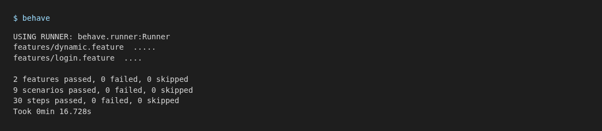

# the-internet BDD tests (behave + Selenium)

Behaviour driven tests written in Gherkin with Python **behave** and Selenium, running against the practice site [the-internet.herokuapp.com](https://the-internet.herokuapp.com). I wanted to practise writing scenarios that a non-technical person can read, and keep the browser code in step definitions.



## Scenarios

| Feature | Scenarios |
|---|---|
| `login.feature` | valid login, two failed logins (scenario outline), logout |
| `dynamic.feature` | add/remove elements, checkboxes, dropdown, dynamic loading, JavaScript alert |

9 scenarios, 30 steps.

## Run it

```bash
git clone https://github.com/Belaalos/the-internet-behave-bdd.git
cd the-internet-behave-bdd
python -m venv .venv && source .venv/bin/activate   # Windows: .venv\Scripts\activate
pip install -r requirements.txt
behave                 # headless Chrome
HEADED=1 behave        # watch the browser
```

Chrome has to be installed. A screenshot is saved to `screenshots/` when a step fails. Tests also run on GitHub Actions.

Belal Magdy | QA | [LinkedIn](https://www.linkedin.com/in/belal-magdy-23sep2001)
